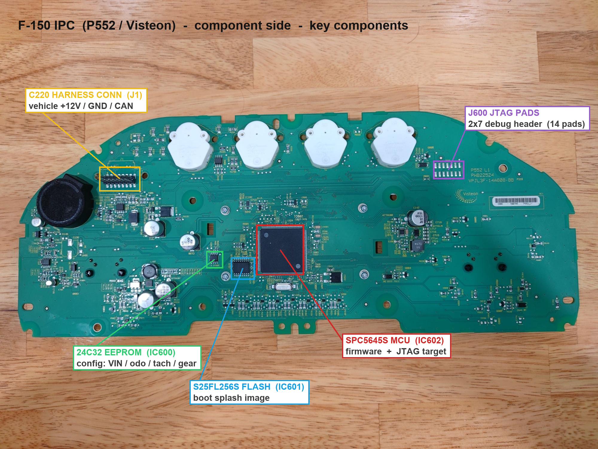
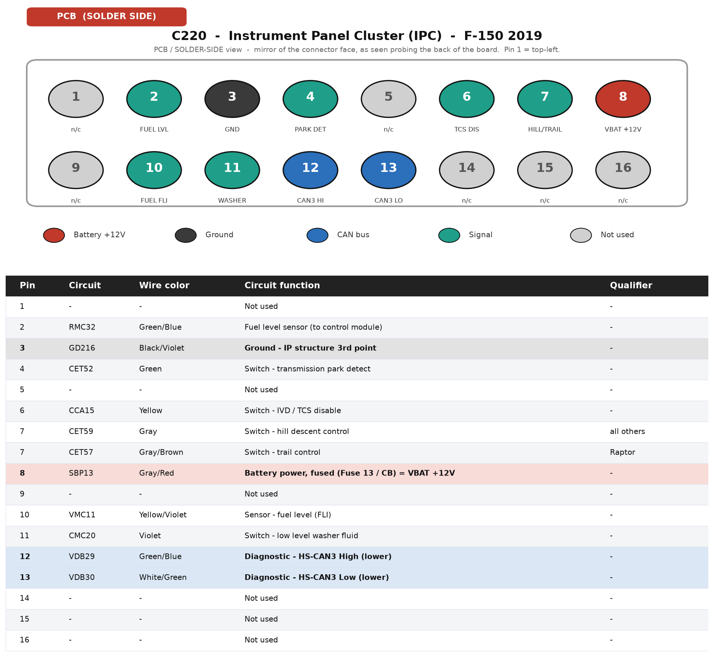
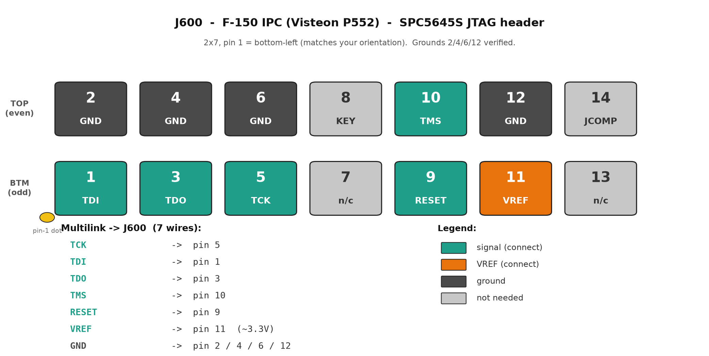
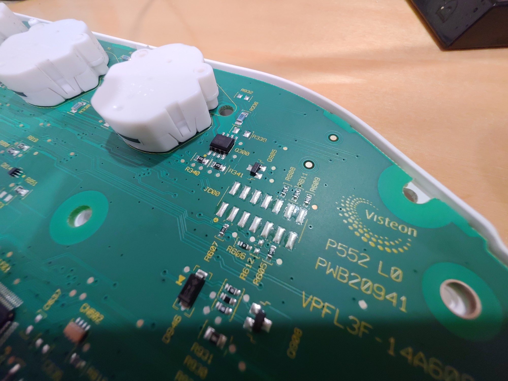
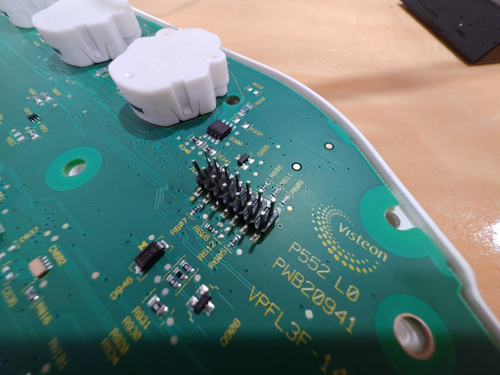
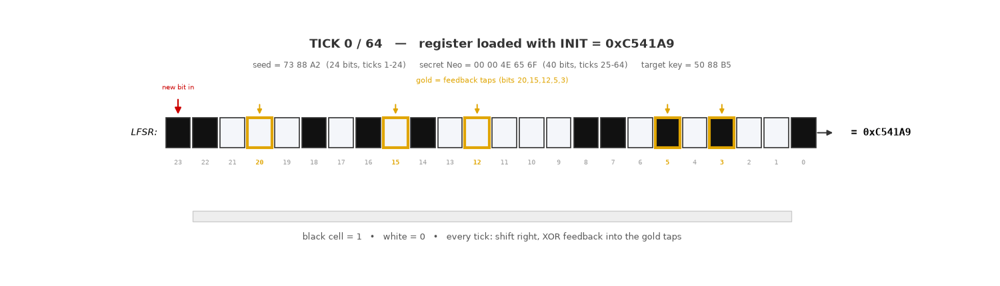
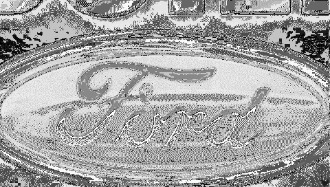
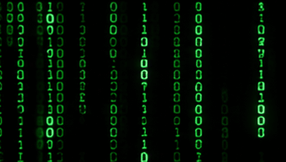

# 2019 Ford F-150 Instrument Cluster (IPC) — Complete Teardown, Reverse-Engineering, and Custom Boot-Splash Guide

### Secrets recovered (proof of method)
| Module | Request/Response | L1 secret | L3 secret |
|---|---|---|---|
| Instrument Panel Cluster (IPC) | 0x720/0x728 | `03 11 19 61 02` | `00 00 4E 65 6F` |
| Restraints Control Module (RCM) | 0x737/0x73F | *not solved* | `00 00 E8 FE B8` |
| Occupant Classification System (OCS) | 0x751/0x759 | *not solved* | `00 00 1D E3 05` |
| Power Steering Control Module (PSCM) | 0x730/0x738 | *not solved* | `00 00 01 1D E4` |

> ⚠️ RCM/OCS/PSCM are safety systems. Published for completeness; never misconfigure a restraint or steering function.

*A full, replicable account of how this cluster works end-to-end: the circuit board, the chips, the memory map, the Ford CAN SecurityAccess wall, the display/boot-splash pipeline, and how to build a custom **color** boot splash. Written so the next person can skip every dead end we hit — including the tools we bought and didn't need.*

> **Scope / ethics:** Everything here was done on my **own** vehicle for legitimate modification (tachometer rescale for aftermarket 8,500-RPM cams, plus a custom boot splash). **No odometer, VIN, or safety-system tampering.** Recovered secrets are published for research completeness. Check your local laws before modifying any vehicle module.

---

Start Here: The Plain English Version

What this project is: I set out to make the tachometer in my 2019 Ford F-150 read higher than the factory gauge allows, and I ended up reverse engineering how the truck’s whole instrument cluster works. This page is the story in plain language. The technical sections further down are the actual instructions. If you just want to understand what I did and why, read this first.

The short version

I put bigger aftermarket camshafts in my truck. They rev higher than the factory gauge can show, so I needed the tachometer to read to 8,000 RPM instead of 7,000. What looked like a simple change turned into a project that stretched across months to crack open the cluster’s software, because Ford locks the part that controls the gauges. This repo documents everything I learned so the next person doesn’t have to spend the hours and money I did.

How it started: a broken engine part

My truck had a part fail called a finger follower. It’s a small lever with a little roller wheel that rides against the camshaft, the shaft that opens and closes the engine’s valves. When that follower fails, it stops rolling smoothly and starts hammering the camshaft, which ruins it. The trouble was I couldn’t tell which follower had failed or which camshaft got chewed up.

The repair became an upgrade

Rather than just replace the broken piece, I decided to build the engine stronger and make more power while I was in there. I bought a set of GSC Stage 2 camshafts made for my engine (the third generation “Coyote” V8), plus GT500 finger followers and GT350 hydraulic lash adjusters to go with them.

The new problem: the gauge can’t keep up

Those new camshafts make their peak power at about 8,100 RPM, and you run them out to 8,500. But my factory V8 tachometer only goes to 7,000. The needle literally runs out of dial before the engine runs out of power.

First idea: swap in the whole V6 cluster

Here’s where the V6 comes in. The V6 version of my truck came from the factory with a cluster that reads all the way to 8,000. So my first move was the obvious one: pull my cluster out, drop the complete V6 cluster into my truck, and clean up anything else through the configuration files.

It read to 8,000 like I wanted, but it brought a new problem with it. The V6 trucks use a 6 speed transmission (the 6R80). My truck has a 10 speed. A cluster is built around the transmission it came with, so a few things on the display don’t match my truck:

Gear count in manual mode (the big one). When you shift into manual mode and pick your own gears, the dash shows which gear you’re in. The V6 cluster only counts 1 through 6, so with my 10 speed I could never see gears 7 through 10. That alone is a dealbreaker.
The gear selector letters at the bottom. Those are the letters that light up for Park, Reverse, Neutral, Drive, and so on. The V6 cluster has seven of them: Park, Reverse, Neutral, Drive, Manual, 2, and 1. My 10 speed only uses five: Park, Reverse, Neutral, Drive, and M for Manual. The good news is both clusters light up the correct letter when you actually shift, so Park reads Park, Reverse reads Reverse, right down the line. The only catch is that the 2 and the 1 on the V6 cluster never light up, because my truck never uses them. Not really a problem, but I’d rather not have dead indicators sitting there.
A few smaller LCD quirks on top of those, which are known issues.

So the full cluster swap gets me the tach range but breaks the gear display. That’s the answer to the obvious question, “why not just run the V6 cluster?” Because you lose four gears on the readout.

Second idea: swap just the gauge face

So I tried the smaller version: leave my own cluster in the truck and swap over only the printed dial face, the one that reads to 8,000, from the V6 cluster. The trouble is that the shifter letters along the bottom of the dash (Park, Reverse, Neutral, Drive, and so on) are printed on that face, and the little lights that illuminate them sit right behind it. The V6 face doesn’t line up with where my V8 cluster puts those lights. So the moment I swapped the face on, the dash lit up the wrong letter: it told me I was in reverse when I was actually in park, neutral when I was in reverse, and so on right down the line. You can’t just swap the faces. That one stopped me dead in my tracks.

The true fix: run the V6 cluster and reprogram it to think like a V8

So here’s where I actually landed, and it’s the opposite of what you’d expect. I run the complete V6 cluster, which already reads to 8,000 and already sweeps the tach needle correctly, and then I reprogram its software so the LCD shows all the V8 information instead of the V6 information: all 10 gears in manual mode, the correct set of selector letters, and the other display pieces that differ between the two trucks. In other words, instead of trying to make my V8 cluster read higher, I take the cluster that already reads higher and teach it to speak my truck’s language. It’s the hard road, but it’s the only version that gets every part of the dash right, and getting into that software is what the rest of this write up is about.

First attempt: the easy door (ForScan)

I started with ForScan, free software a lot of Ford owners use, plus a cheap adapter that plugs into the truck’s port. I went through every setting I could find. I even spotted some “8,000 RPM” options, but those turned out to be for Fords with fully digital dashboards, not my analog needle and dial setup. Dead end.

Understanding the lock

Here’s the key idea the whole project hinges on. The cluster will only let you change things if you give it the right “password” first, and there are different passwords for different levels of access. Think of a building where your wristband only gets you into certain rooms:

Level 3 is the owner friendly wristband. It’s what ForScan uses, and it lets you toggle the nice convenience stuff: seatbelt chimes, the four wheel drive menus, trailer brake screens, and so on.
Level 1 is the deep access wristband. The gauge calibration, the thing I actually need, lives behind this door, and Level 3 doesn’t open it.

So the real goal narrowed down to: get Level 1 access.

The $120 dead end

I bought a two day subscription to Ford’s official software, hoping to reflash (reinstall) the cluster’s software. My plan was that during an official update I could quietly record the Level 1 “handshake” as it went by and capture the password. Problem: the tool only lets you reflash if your cluster is behind on its software version. Mine was already up to date, so it refused to do anything. $120 gone, door still locked.

Going to the source: Ford’s own files

I wasn’t willing to quit. I figured if it exists, it can be done. After a lot of digging I found Ford’s actual firmware files available online (through Ford’s motorcraft service site, worth double checking the exact source). I downloaded them, decompiled them (translated the raw code into something readable), and started mapping out how everything worked.

While I was this deep anyway, I added a second goal for fun: the boot splash screen. When you turn the key, the cluster plays a little animation, a chunk of steel stamped “Built Ford Tough” slamming into concrete. It looks cool, but I wanted to put my own graphic there instead.

The four pieces of software (what’s actually inside)

Digging through the files, it comes down to four parts. (The exact file names are in the technical sections.)

The primary bootloader, the cluster’s innermost startup program, living in protected memory. Ford does not give this one out.
The secondary bootloader, a helper that loads during updates.
The splash screen / graphics file, the startup animation and other on screen imagery.
The EEPROM, a small memory chip that remembers settings even with the battery disconnected. This is where the gauge calibrations live (the tach, speedometer, and the other needles), along with vehicle identity info like the VIN and the mileage.
A shortcut from a stranger on Reddit

Someone on Reddit pointed out something important: the tachometer calibration sits in that EEPROM chip, and you don’t actually need the Level 1 password to get at it. You can buy a little clip that attaches directly to the chip, plus a device that talks to it, and read the chip’s contents off and write new contents back on, going around the main processor entirely. So that’s what I did for the gauge calibration. The splash screen graphics chip works the same way; it’s a different size, so it needs its own clip, but the idea is identical: clip on, read and write directly, skip the locked front door.

The catch that sends me back to Level 1

Here’s the snag. The splash screen’s color (that signature blue) isn’t stored in the graphics file. It appears to live in the primary bootloader, the one locked piece Ford won’t hand out. So to fully control the splash screen, I still need inside that bootloader, which means I still need the Level 1 secret after all.

The backdoor: JTAG

More digging turned up the way in. These cluster boards have a small set of connection points called a JTAG header — essentially a maintenance port chip makers use to talk straight to the processor. So I soldered a tiny 2×7 header onto those pads, hooked up my JTAG tool (a PE Multilink), and pulled the primary bootloader — the one file Ford won’t hand out — right off the chip.

It didn’t come easy. The connector isn’t keyed, so it only works flipped one way around (the tell: the stepper motors make no noise (Zeroing out) on power-up when the connector is arranged incorrectly). The processor locks the JTAG port the instant the normal software boots, so I had to catch it right at the moment of power-on, power-cycling the cluster over and over until the tool finally latched. But once it did, the whole bootloader came off the chip.

Then I decompiled it, and there it was — the Level 1 secret, sitting right in the code, exactly where I figured it’d be. That’s the backdoor, and it’s open. With it I’ve got full access to read, change, and customize anything on this cluster: the gauge calibration I was chasing, the custom boot splash, all of it.

What else I’m mapping along the way

While doing all this, I’ve been documenting everything about how the cluster works: what controls the warning LEDs on the board, what drives each stepper motor (fuel, transmission temp, engine temp, oil pressure, and the rest), so that eventually anyone can customize any part of this instrument cluster, not just the tach.

Where I am right now

I’m waiting on the JTAG header pins to arrive in the mail (expected early December). Once they’re here, I solder them on, pull the bootloader, and we should be able to wrap this up.

Why I’m sharing all of this

I spent tens of hours and real money hitting dead ends to figure this out. I’m putting it all here, free and in the open, so the next person can skip the dead ends and jump straight to the part that works.

---

# PART 1 — The Hardware

The cluster opens up to one main PCB — a **Visteon "P552 L1"** board (board markings `PWB22524` / `VPJL3F-14A608-BB`). Key components (verified off the board):



*Component side of the board with everything we reference boxed: **C220** harness connector (J1, yellow), **24C32 EEPROM** (IC600, green), **Spansion S25FL256S** flash (IC601, blue), **SPC5645S MCU** (IC602, red), and the **J600 JTAG** pads (purple).*

| Ref | Part | Function |
|---|---|---|
| **MCU** | **ST SPC5645S** (= NXP **MPC5645S**, same silicon), 208-LQFP | Cluster processor. PowerPC **e200z** core, **VLE** instruction set. Integrates a display controller (**DCU3**), a 2D/OpenVG accelerator, stepper-motor controllers, CAN, etc. |
| **IC600** | **24C32** EEPROM, 8-pin SOIC (I²C) | Per-cluster config: **VIN, odometer, gauge calibration tables, FORScan As-Built**. |
| **IC601** | **Spansion S25FL256S**, 16-pin SOIC | **32 MB SPI NOR flash** = the graphics/boot-splash partition. Memory-mapped at `0x70000000`. |
| **IC602** | the SPC5645S (208-LQFP) | (same MCU as above) |
| **LCD** | **Sharp LQ042T5DZ07** | 4.2" **480 × 272** WQVGA, **18-bit RGB666** (262K colors), **TTL parallel RGB** interface, WLED backlight. A "dumb" panel — no command protocol; the DCU3 streams a framebuffer to it as parallel RGB + pixel-clock/HSYNC/VSYNC/DE. **All color handling is in the DCU/firmware, not the panel.** |
| **CAN xcvr** | **NXP TJA1042** (8-pin) | High-speed CAN transceiver (the cluster's bus interface). |
| op-amp **†** | a **"2904V"** (dual op-amp, 8-pin) | Analog signal conditioning. |
| **Gauges †** | 4× **Sonceboz 6405** small steppers + 2× **Sonceboz 6403** for tach/speedo | Air-core stepper gauges: oil pressure, engine temp, fuel, trans temp (small), tach + speedo (large). 18° rotor, 36:1 gear, ~300° sweep ≈ 3,600 microsteps full scale. |

> **† Marking-read confidence:** the **Sonceboz stepper numbers (6405 / 6403)** and the **"2904V" op-amp** were read off chip markings that were genuinely hard to make out on the board — tiny, low-contrast, and partially obscured. **This is our best read; we're fairly confident but not 100% sure.** If you're replicating, **double-check these against your own board** before relying on them. Everything else in this table (MCU, EEPROM, Spansion, panel, CAN transceiver, connector pinout) is confirmed.

**Connectors / pads:**
- **C220** (a.k.a. **J1**) — the 16-cavity (2×8) main harness connector. Key pins: **8 = VBAT (+12 V)**, **3 = GND**, **12 = HS-CAN3 High**, **13 = HS-CAN3 Low** (plus fuel-level, park-detect, washer, and switch signals). Full pinout:



- **J600** — a **2×7 JTAG pad array (14 pads) on the COMPONENT side** of the board: the debug port for dumping/flashing the MCU over JTAG. Pin 1 is bottom-left. A 2×7 SMT header solders here. Pinout:



*JTAG wiring: **TDI**=1, **TDO**=3, **TCK**=5, **RESET**=9, **TMS**=10, **VREF**=11 (~3.3 V), **GND**=2/4/6/12. Pin 8=KEY, 14=JCOMP, 7/13=n/c. (A PEmicro Multilink or any PowerPC/e200 JTAG probe maps straight onto these.)*


*The J600 debug port as it comes: a bare 2×7 SMD pad array on the component side.*


*After: a 2×7 header soldered to J600, ready for the JTAG ribbon.*

> **Note — done on a sacrificial board.** I worked out the solder-and-dump on a **spare cluster with the low-end monochrome LCD** (the pixely blue-teal screen), **not** the 4.2″ color unit — so there was zero risk of bricking the good cluster while I figured out the JTAG process. The J600 header and the MPC5645S are identical on both boards, so the bootloader dump is the same either way.

**Bench behavior:** powering the board on a bench supply (≈1.5 A) makes all the steppers sweep fully one way and click (re-zeroing). The **LCD does not light up** on the bench — it needs the full in-vehicle harness/signals — so **visual splash testing requires the cluster installed in the truck.**

**Stepper re-zero note:** the gauges only sweep-and-zero on **power loss**, not on every key-on, because the cluster keeps a constant VBAT feed and stores needle position in memory. (Relevant if you ever trailer the car long-distance — physical jostling could desync a needle and it won't auto-correct until a power cycle.)

---

# PART 2 — Memory Map (what lives where)

From the **MPC5645S Reference Manual, Chapter 2** (free NXP download — see Part 7). The addresses that matter:

| Address range | Region | Notes |
|---|---|---|
| `0x00000000`–`0x001FFFFF` | **Internal Code Flash (2 MB)** | `0x0`–`0x8000` = **primary bootloader**; `0x8000`+ = **application** |
| `0x40000000`–`0x4000FFFF` | Internal SRAM | Layer-config shadow at `0x40005300` |
| `0x60000000`–`0x600FFFFF` | **1 MB graphics SRAM** | Framebuffer/compositing work area |
| `0x70000000`–`0x77FFFFFF` | **External Serial Flash A** | ← **this is the Spansion** = the graphics/splash partition |
| `0xC3F90000` | **SIUL** (System Integration Unit Lite = GPIO/pins) | ⚠️ NOT the display controller (we wasted time here) |
| `0xFFE5C000`–`0xFFE5FFFF` | **DCU3 (Display Control Unit)** | ← the LCD controller. **CLUT is here.** |
| `0xFFE58000` | DCULite | Second, smaller display controller |
| `0xFFE60000` | Stepper Motor Controller (SMC) | Drives the gauge steppers |
| `0xFFFC0000`+ | FlexCAN 0/1/2 | CAN controllers |

**The three directly-editable targets (no SecurityAccess):**
1. **EEPROM (24C32)** → VIN / odometer / gauge calibration / As-Built. (I²C clip.)
2. **Spansion SPI flash** (`0x70000000` space) → splash **images**. (SPI clip, or the free Ford `KL3T-14C088` VBF.)
3. Everything else (program + splash **colors**) is in the MCU's internal flash → needs JTAG or an unlocked flash session.

---

# PART 3 — Ford CAN SecurityAccess (service 0x27): the LFSR keygen and why Level-1 is the wall

*(This is the "how do I reflash firmware over the bus" story. **You can skip all of it if you only want the tach or splash-image mods** — those are external chips. It matters only for firmware/CLUT changes.)*

### L1 vs L3
- **Level 3 (L3)** = extended/config access (As-Built). **Solvable.** This is also what a free FORScan extended license already gives you on these modules.
- **Level 1 (L1)** = firmware/programming access. **The wall.** You can only capture an L1 unlock *while a module is actively being flashed*, and Ford's tool only flashes a module that's **behind on its calibration**. Current cluster = no flash = nothing to capture. And the L1 secret is **not in any downloadable file** — it's in the MCU's **primary bootloader**.

### The keygen (legacy 24-bit Galois LFSR — same constants for all legacy Ford modules)
- **Initial state:** `0xC541A9`
- **Feedback taps:** bits 20, 15, 12, 5, 3 (= `0x109028`)
- **One tick:** `feedback = (next input bit) XOR (bit0)`; shift right 1; if `feedback==1` flip the 5 tap bits; `feedback` enters at bit 23.
- **Full run (64 ticks):** load `0xC541A9` → clock in 24 **seed** bits, then 40 **secret** bits → take the final 24-bit register, **rearrange its 6 nibbles in a fixed order** → 3-byte key.
- **Verified vector:** `seed=1F 7C 69`, `secret=00 00 FA 5F C0` → `key=9A 64 CE`.

A real run — seed `73 88 A2` + a secret, 64 ticks, watch the bits shift right and the tap bits fire, and the key `50 88 B5` drops out:



### The "plug-and-solve" linear form
Because it's all XOR (linear over GF(2)):
```
key = (A · seed) XOR (B · secret) XOR C      where C = 0x293F78
```
Flip it: `B·secret = key XOR (A·seed) XOR C`. **One captured `(seed,key)` pair** → 24 equations in 40 unknown secret bits → Gaussian elimination → `2^16 = 65,536` secrets all satisfy it, and **every one unlocks** (for all seeds). You can't recover the *unique* factory secret, but you don't need to.

### Secrets recovered (proof of method)
| Module | Request/Response | L1 secret | L3 secret |
|---|---|---|---|
| Instrument Panel Cluster (IPC) | 0x720/0x728 | `03 11 19 61 02` | `00 00 4E 65 6F` |
| Restraints Control Module (RCM) | 0x737/0x73F | *not solved* | `00 00 E8 FE B8` |
| Occupant Classification System (OCS) | 0x751/0x759 | *not solved* | `00 00 1D E3 05` |
| Power Steering Control Module (PSCM) | 0x730/0x738 | *not solved* | `00 00 01 1D E4` |

> ⚠️ RCM/OCS/PSCM are safety systems. Published for completeness; never misconfigure a restraint or steering function.

### Which modules are even locked
Most convenience modules **aren't** — doors (DDM/PDM), radio (RTM), front-controls (FCIM) take As-Built writes with **no** seed/key. Only **safety modules + the IPC** gate config. (ABS and IPMA use a *different, longer* key scheme our LFSR solver does **not** cover — they reject with NRC `0x13`.)

### Sniffing gotchas (cost us real time)
- **OBDLink EX (STN chip):** use **STN-native monitor** (`STP53`/`STPBRxxxxxx`/`STPO`), **not** `ATSP6` — with `ATSP6` it captures **zero** frames.
- **Be on the module's bus:** the EX only taps **HS-CAN (pins 6/14)**. IPC is there (works); **APIM/SYNC is on another bus** (invisible to the EX).
- **APIM/SYNC updates over USB** (signed package), **not** a CAN SecurityAccess flash — there's no seed/key to sniff. Don't chase it.

### Why the subscription is a dead end for L1
The $120 FJDS/FDRS subscription only flashes a module that's **behind**. On a current cluster it shows "No later calibration available," never starts a programming session, never sends `27 01`, so there's **nothing to capture**. (One untested idea: an active CAN device that *emulates* the IPC reporting an **old** calibration number, to trick the tool into starting a flash — needs a valid older part number, which we couldn't find. Unproven.)

### Which Ford software by model year (this is genuinely confusing)
- **IDS** = ~1996–2018. **Does NOT cover 2019.**
- **FDRS** = current native tool for newer platforms.
- **FJDS** = **module reprogramming for 2018+** via J2534. **This is the one** that reached the 2019 IPC.

---

# PART 4 — The firmware files Ford gives away FREE

The IPC firmware VBFs are **free downloads from motorcraftservice.com — no subscription.** (The $120 only buys the *tool* that flashes a module; the files are free.)

| File | What it is | Size |
|---|---|---|
| `KL3T-14C026-BD.vbf` | **The cluster application firmware (EXE)** — the correct one | ~2 MB |
| `KL3T-14C088-AD.vbf` | **The 32 MB graphics/splash partition** (Spansion content) | ~32 MB |
| `JR3T-14C025-JA.vbf` | The **secondary (RAM) bootloader** (SBL) — runs only during a flash | small |
| ~~`JL3T-14C026-AF.vbf`~~ | **WRONG variant** — 1 MB, does not drive the display. Don't use it. | ~1 MB |

**Why free files matter:** normally you can't read firmware off your own module (UDS `0x23` ReadMemoryByAddress is gated behind the L1 secret). Ford handing you the VBFs means the splash and app reverse-engineering can start **today**, no chip dump. The **only** piece not distributed is the **primary bootloader** (and its L1 secret).

### VBF format (how to extract the raw firmware)
A VBF is an ASCII header `{ ... }` (with `sw_part_number`, `sw_part_type`, `ecu_address`, `erase = {start, len}`, `file_checksum`) followed by binary blocks. Each block: **4-byte start address (BE)**, **4-byte length (BE)**, the data, then a **2-byte checksum**.
- `KL3T-14C026-BD`: one block at **`0x8000`**, length `0x1F8000` (2 MB), ECU `0x720` (IPC). → that's the application, loaded at `0x8000`.
- `KL3T-14C088-AD`: one block at **`0x70000000`** (the Spansion address space), 32 MB.

---

# PART 5 — The Boot-Splash / Display System (how it actually works)

The factory images are stored in black and white, the primary bootloader "adds" the color, which we don't have level 1 access to... yet.  This is the part this write-up adds over the earlier one. The stock "BUILT FORD TOUGH" boot animation, rebuilt directly from the graphics partition:



The display pipeline is:

```
Primary Bootloader  ─┐
                     ├─► configures DCU3 layers ─► DCU3 reads framebuffer ─► streams RGB666 to the Sharp panel
Application firmware ─┘        + loads the CLUT (color palette) into DCU RAM
       (framebuffer / raster = the indexed images in the Spansion flash @ 0x70000000)
```

### The splash raster (the pixels) — in the Spansion flash
- Stored as **~25 back-to-back frames**, each **480×272 at 8 bits-per-pixel** (1 byte/pixel, linear; **130,560 bytes/frame**), in the graphics partition starting at file offset **`0x231472`** (call it `ANCHOR`). Frame *k* is at `ANCHOR + k·130560`, for `k = -2 … 22`.
- **Each byte is a palette INDEX**, not a brightness. (On the DCU3, an 8bpp layer is **always** CLUT-indexed — there is no grayscale hardware mode.) So the image you see is `CLUT[pixel_byte]`.
- This is why you can replace the splash image on the bench: the raster is just indexed pixels in the SPI flash. (The existing grayscale custom splash works exactly this way.)

### The DCU3 (display controller) — register map that matters
From the **MPC5645S RM, Chapter 11**. **DCU3 base = `0xFFE5C000`.** Within it:

| Offset | Region |
|---|---|
| `0x0000`–`0x03FF` | Registers (incl. 16 layer descriptors) |
| `0x0800`–`0x13FF` | Gamma R/G/B tables |
| **`0x2000`–`0x3FFF`** | **CLUT / tile RAM** — the color palettes |

- **Layer descriptors:** `CtrlDescLn_1..7` at `0xFFE5C000 + n·0x1C` (7 registers × 16 layers). `CtrlDescLn_1` = size, `_3` = **framebuffer pointer** (points into the Spansion at `0x70…`), **`_4` = format/encoding** (the field that selects **8bpp-CLUT** = value 3; there is no grayscale mode) + the `LUOFFS` palette offset.
- **The CLUT itself:** **`0xFFE5E000`** (`base + 0x2000`), up to **2048 entries**, each a **32-bit ARGB word (`0xAARRGGBB`)**. An 8bpp layer uses 256 of them starting at its `LUOFFS`.

**So the splash's palette is 256 × 32-bit *color* entries at `0xFFE5E000`.** It looks gray only because those entries currently hold gray values (R=G=B). **Change them → color.** No format change, no panel change.

### Who loads the CLUT (and the big discovery)
In the **application** (`KL3T-14C026-BD`), the only function that writes the CLUT (`FUN_00071a28` in our Ghidra project) **copies palettes out of a firmware table** into `0xFFE5E000`:
- The table is at **VA `0x13CCD0`**, 8-byte entries = **`{source_pointer, entry_count}`**, indexed by CLUT ID.
- The CLUT data is stored contiguously from **`0x132118`**, each palette = `count` × 4-byte ARGB.
- There are **142 palettes** — and they are **all the colorful UI palettes** (icons, gauges, menus: oranges, blues, greens). **None is a 256-entry grayscale ramp.**

That's the key finding: **the application never writes a gray palette.** So the **boot splash's gray palette is written by something that runs *before* the app — the primary bootloader (PBL)**, resident at `0x0–0x8000`, which paints the splash in the first milliseconds of power-on and then hands off to the app. (The secondary bootloader/SBL is *not* it — the SBL only runs from RAM during an active reflash and never shows the splash.)

**Consequence:** recoloring the splash = editing the CLUT write in the **PBL**. The PBL is not a distributed VBF, so we need a **JTAG dump of `0x0–0x8000`**. (And re-flashing it needs SecurityAccess L1.)

---

# PART 6 — Building a Custom COLOR Splash (the practical pipeline)

Everything except the final flash is done and in this repo.

### The constraint
The panel shows **256 colors total** (one shared CLUT), 480×272, 8bpp indexed. So any color image must be reduced to **one optimized 256-color palette**, and the pixels re-indexed to it.

### The pipeline (scripts/notes included)
1. **Source art:** 25 color frames at native **480×272** (we used an AI-generated color animation; any 480×272 color frames work).
2. **Shared 256-color palette:** quantize all 25 frames *together* (median-cut) so one palette serves the whole animation; dither with Floyd–Steinberg for smooth gradients.
3. **Re-index** every frame's pixels to that palette → new 8bpp raster.
4. **Luminance-sort the palette** (sort entries dark→bright and remap indices to match). This is the clever bit: it makes the new raster display as a **clean grayscale** version under the *stock* gray palette, and **full color** once our palette is loaded — graceful degradation, so you can flash and verify the image before the palette problem is solved.
5. **Pack** the re-indexed frames into the graphics-partition `.bin` at `ANCHOR + k·130560` (k=-2…22), exactly where the stock frames live. Flash it like any graphics update.

**Deliverables in this repo:**
- `COLOR_SPLASH_graphics.bin` — the 32 MB graphics partition with the color animation packed in (shows grayscale with the stock palette, color once the CLUT is updated).
- `COLOR_SPLASH_palette_256.bin` — the 256-color palette (ready to write into the CLUT once we can patch the PBL).
- `COLOR_SPLASH_preview.gif` — what it looks like in color.

Our custom color splash (256-color, built from the pipeline above):



**What's left:** write `COLOR_SPLASH_palette_256.bin` into the splash CLUT. That lives in the **PBL** → JTAG dump + L1 to flash.

---

# PART 7 — Reverse-Engineering Toolkit & Methodology (replication guide)

### Tools that actually worked
- **Ghidra 11.4.3** + **JDK 21** (Eclipse Temurin). *Not* Ghidra 12.2 / JDK 25 (they crash on OSGi/Felix). 
- **pypdf** (Python) to extract text/tables from the NXP reference-manual PDF.
- **Python + numpy + Pillow** for all the image/palette/packing work.
- A free **NXP account** to download the **MPC5645S Reference Manual (`MPC5645SRM`)** — this single document is what cracked the display analysis (memory map + DCU3 chapter). Get this *first*.

### Ghidra setup for SPC5645S firmware (the exact gotchas)
1. Extract the raw firmware from the VBF (the block at `0x8000`).
2. Import as **Language `PowerPC:BE:64:VLE-32addr`**, **base address `0x8000`**, Raw Binary loader.
3. **CRITICAL:** the VLE language has a context register named **`vle`** that defaults to **0**, which decodes everything as *plain* PowerPC (garbage — `bdnzf`, `lfs`, `lwz`). Before disassembling, **set `vle = 1`** over the whole image (clear existing code units first, then `ProgramContext.setValue(vle, start, end, BigInteger.ONE)`). Then analyze. Now you get real VLE (`se_*`, `e_bl`, `e_lis`).
4. **Don't force-disassemble the whole block with follow-flow** — it chases branches into data and thrashes (we produced a 5 GB log once). Let normal auto-analysis run, then target specific functions.

### How we found the CLUT (the method, so you can repeat it)
1. RM memory map → DCU3 base `0xFFE5C000`, CLUT at `+0x2000`.
2. In Ghidra, find functions with **resolved references into `0xFFE5C000–0xFFE60000`** → the one touching `0xFFE5E000` is the CLUT writer (`FUN_00071a28`).
3. Decompile it → it copies from a `{ptr,count}` table → dump that table → classify each palette as gray vs color.
4. Confirm the app has no gray 256-palette → conclude the splash palette is in the PBL.

---

# PART 8 — 🚫 WHAT YOU DON'T NEED TO DO (the full skip-list)

We tried a lot of things that turned out unnecessary. Learn from them:

**Tools/purchases you can skip (for the tach & splash mods):**
- The **$120 Ford diagnostic subscription** (FJDS/FDRS) — unnecessary for EEPROM/SPI edits.
- A **J2534 clone (VXDIAG VCX Nano)** — same.
- **IDS** entirely for a 2019 (no coverage).
- Chasing **APIM/SYNC** as a flash target — it updates over USB, no CAN seed/key.

**Software/analysis dead ends:**
- **Ghidra 12.2 / JDK 25** — OSGi/Felix crash; use **11.4.3 + JDK 21**.
- **Capstone** for disassembly — no VLE mode.
- **Byte-scanning** firmware or the graphics partition for the palette — it's runtime DCU RAM, not a static table. (We did this ~8 different ways. All futile.)
- Treating **`0xC3F90000`** as the display controller — it's **SIUL/GPIO**.
- The **`JL3T-14C026-AF`** 1 MB firmware — wrong variant, no DCU code. Use **`KL3T-14C026-BD`** (2 MB).
- Forgetting the **`vle` context register** in Ghidra — guarantees garbage.
- A **"palette probe"** flash-and-photograph approach — only needed if you *can't* get the reference manual. With the RM it's deterministic; skip it.

**Conceptual traps:**
- Thinking the splash is "grayscale by hardware" — **it's indexed color**; gray is just the palette values.
- Thinking the **app** sets the splash palette — it doesn't; the **PBL** does.
- Thinking you need **L1** for the tach or the splash *image* — you don't; only for firmware/CLUT.

---

# PART 9 — Current Status & What's Next

**Done:**
- Full hardware ID, memory map, and SecurityAccess analysis.
- Complete display-pipeline reverse-engineering: DCU3 at `0xFFE5C000`, CLUT at `0xFFE5E000` (256× ARGB), layer format fields, the app's 142-palette UI CLUT table, the CLUT loader, and the conclusion that the splash palette is in the PBL.
- A custom **color** splash fully designed, quantized, re-indexed, and packed — plus a grayscale-fallback build that's flashable today.

**Next (blocked on hardware in the mail):**
1. Solder the **2×7 header onto J600** and attach a **PowerPC JTAG debugger**.
2. **Check JTAG censorship** first — the SPC5645S has a factory read-protect lock. If open, a dump of `0x0–0x8000` just works; if locked, that's a separate problem (glitch attack, no turnkey recipe).
3. **Dump the primary bootloader** (`0x0–0x8000`), find its splash CLUT write, and point it at `COLOR_SPLASH_palette_256.bin`.
4. Re-flash (needs L1) → **color splash on the dash.**

**The end goal** (why this write-up exists): document the whole cluster so anyone can do this, and build a **pogo-pin JTAG jig** that clips onto `J600` to read/patch any cluster someone mails in — custom splash + settings, no gatekeeping, no $640 "service."

---

*Disclaimer: performed on my own vehicle for legitimate repair/modification. No odometer, VIN, or safety-system tampering. Recovered secrets published for research completeness only. Verify local laws before modifying any vehicle module.*
