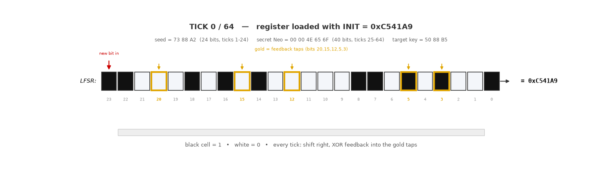
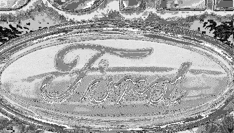

# 2019 F-150 IPC tach reflash — the Ford UDS SecurityAccess (0x27) keygen, L3 secrets, which Ford software by model year, and why Level-1 is the real wall

**TL;DR** — The legacy Ford SecurityAccess algorithm is a known 24-bit LFSR, and **Level-3 (config/As-Built) secrets are trivial to recover** by sniffing one unlock and solving. **Level-1 (firmware-flash) is the wall**: you can only sniff an L1 unlock *while a module is actually being flashed*, and the Ford software will only flash a module that is **behind on its calibration**. If everything's up to date, there is no way to make it write, so there's nothing to sniff. The L1 secret is **not** in the downloadable firmware files either — it lives in the module's resident primary bootloader *inside the MCU*, reachable only by reading the chip directly. (And for the actual tach and splash mods, it turns out you don't need L1 at all — those live in separate external memory chips you can read directly.) Posting this so the next person doesn't spend the money/time to re-discover it.

---

## What I was actually trying to do
I put a set of aftermarket **camshafts** in my 5.0L Coyote — they make peak power around **8,100 RPM** and I run them toward an **~8,500 RPM** redline. The stock F-150 cluster tops the tach scale at **7,000**, so past that it's meaningless. The goal was to make the tach sweep correct for the new RPM range. Purely cosmetic/informational — **not** touching odometer, VIN, or anything safety-related. At first I assumed the tach scaling lived in the cluster's *firmware* (which would make it a Level-1 / flash problem), and that assumption sent this whole write-up down the SecurityAccess road. I later learned the scaling actually lives in a small **external EEPROM** chip on the cluster board — directly editable without any of the Level-1 work below. The Level-1 firmware access turned into its own separate line of investigation.

---

## The approaches we tried, and why each one hit a wall
The full journey, dead ends included, so you can skip the ones that don't work. Roughly in order:

**1. Throwing the public secret lists at Level-1 (FoCCCus / KEYBAG, ~349 known secrets).**
Tools: **FORScan** + **OBDLink EX**, brute-force script.
→ Every one rejected at L1 (NRC `0x35`). The IPC's L1 secret is not in any public list. ❌

**2. Sniffing a Level-3 (As-Built) unlock and solving the algorithm.**
Tools: an OBD2 **Y-splitter** + **OBDLink EX** (running FORScan to do the unlock) + an **OBD Monster** ELM327 clone as a passive sniffer + our solver.
→ ✅ This part *worked* — it's how we recovered the L3 secrets and confirmed the 24-bit LFSR. **But L3 only unlocks configuration, not firmware** — it can't reflash the cluster, so it didn't get us to the goal. ❌ (for the firmware goal)

**3. Buying a Ford subscription tool to flash the IPC (so we could sniff a Level-1 unlock).**
Tools: **VXDIAG VCX Nano** (J2534 clone) + the **$120 / 2-day Ford subscription**, trying **IDS → FDRS → FJDS** in turn.
- **IDS** — doesn't cover a 2019, and the VXDIAG's older driver library wouldn't run current IDS (ERROR 2). ❌
- **FDRS** — driver/VMS issues, wrong path for this cluster. ❌
- **FJDS** — the *correct* tool; it reached IPC Module Reprogramming. But it reported **"No later calibration available"** — the cluster was already up to date, so it refused to flash. No flash = no L1 unlock to sniff. Tried sacrificial clusters too; all current. ❌

The core wall here: **the Ford software only flashes a module that is *behind* on its calibration, and gives you no way to just edit firmware.** If everything's current, there is nothing to sniff.

**4. Using the APIM/SYNC module as a "behind on calibration" target instead.**
Tools: FJDS + VXDIAG + the OBDLink sniffer.
→ Failed two ways: (a) the **APIM is on a different CAN bus** than the OBDLink EX can tap — the EX only sees HS-CAN on pins 6/14, and SYNC is on another bus, so the sniffer never saw its traffic; and (b) more fundamentally, **SYNC firmware updates over USB** (a signed package), *not* a CAN SecurityAccess flash — so there's no seed/key on the bus to capture anyway. ❌

**5. Extracting the L1 secret from the downloadable firmware (VBF) files.**
Tools: the Ford VBFs (app EXE, SBL, graphics DATA partition) + our own analysis scripts.
→ The L1 secret lives in the **resident primary bootloader**, which Ford does **not** distribute. The app EXE only carries the *L3* secret; the SBL is just a RAM flash-driver that runs *after* you're already unlocked. The L1 secret is in **none** of the downloadable files. ❌

**→ The path we're testing next: dump the MCU directly.**
The primary bootloader — L1 secret and all — is physically inside the cluster's MCU (an **ST SPC5645S**, 208-LQFP). **If** that chip isn't read-protected, you could JTAG-dump it, find the keygen in the firmware, and read the secret out — no Ford, no subscription. One experienced person reports these clusters aren't locked, but **we have not verified that ourselves yet** — proving it is the next step. Hardware (a PowerPC JTAG debugger + a 208-pin QFP clip) is on order; this write-up continues once we've actually tried it.

**The kicker:** the *actual mods* may not need the L1 secret at all. The **tach scaling lives in an external `24C32` EEPROM** and the **boot splash in an external Spansion SPI flash** — both of which can be read/written directly with a chip programmer, no SecurityAccess involved. Recovering the L1 secret is a separate goal from getting the mods done.

## 1) Which modules use which algorithm
On a 2019 F-150 (HS-CAN1, 500k, 11-bit), probing SecurityAccess (service `0x27`) sorts modules into two buckets:

- **Legacy 24-bit LFSR (SOLVABLE):** 3-byte seed, 3-byte key. This is the one we can beat. Confirmed on **IPC, RCM, OCS, PSCM**, and others reject with NRC `0x35` (= our algorithm, wrong key → crackable by capture+solve).
- **Different algorithm (NOT this one):** longer multi-byte key, rejects with NRC `0x13` (wrong key *length*). Seen on **ABS and IPMA (fwd camera)**. This is a different/stronger scheme — the LFSR solver does not apply.

**We only have the equation for the LFSR bucket.** The `0x13` modules are a separate problem we did not solve.

---

## Which modules are even protected (most convenience modules aren't)
Before anyone goes hunting secrets, know this: **most of the convenience/comfort modules aren't locked at all.** We sniffed FORScan doing guided As-Built config writes across the truck and watched which modules demanded a SecurityAccess key and which just took the write:

- **No security at all — config writes go straight through (no seed, no key):** the **doors** (DDM / PDM), the **radio transceiver** (RTM), and the **front-controls module** (FCIM). (The body module / APIM / PCM didn't even issue a seed.) You just write the As-Built and it sticks.
- **The only modules that demanded a key were safety / driver-assist:** **RCM** (airbag), **OCS** (occupant classification), **PSCM** (steering) — all our solvable LFSR — plus **ABS** (brakes) and **IPMA** (forward camera), which use a *different, longer* key scheme our solver doesn't cover. And the **IPC** — the one comfort-ish module that gates its config (that's the `Neo` L3 secret).

## 2) The LFSR keygen — the actual equation
It's a **24-bit Galois LFSR**. Two constants define it (same for every legacy Ford module):

- **Initial state (loaded before anything):** `0xC541A9`
- **Feedback taps:** bits **20, 15, 12, 5, 3** (= `0x109028`)

**How one tick works:**
1. `feedback = (next input bit) XOR (bit 0, the bit shifting out)`
2. Shift the whole 24-bit register right by one.
3. If `feedback == 1`, flip the 5 tap bits (20/15/12/5/3). If `0`, don't.
4. The `feedback` bit itself enters at bit 23.

**The full run (64 ticks):**
- Load `0xC541A9`.
- Clock in the **24 seed bits** (ticks 1–24), then the **40 secret bits** (ticks 25–64). Seed = 3 bytes, secret = 5 bytes, 24 + 40 = 64.
- After 64 ticks, take the final 24-bit register and **rearrange its 6 nibbles in a fixed order** → that's your 3-byte key. (The nibble shuffle is just one more baked-in constant; no new math.)

**Verified published test vector:**
```
seed = 1F 7C 69   secret = 00 00 FA 5F C0   ->   key = 9A 64 CE
```
(Matches two independent public implementations across thousands of random vectors.)

A real run — seed `73 88 A2` + a secret, 64 ticks, watch the bits shift and the gold taps fire, key `50 88 B5` drops out:



---

## 3) The compact "plug-and-solve" form
Because every operation is XOR (it's linear over GF(2)), the whole thing collapses to:

```
key = (A · seed)  XOR  (B · secret)  XOR  C
```
- `C = 0x293F78` (what `0xC541A9` becomes after 64 zero-input ticks — a fixed constant)
- `A`, `B` are fixed bit-selector matrices (24×24 and 24×40). Each output key bit = XOR of a fixed set of seed bits + secret bits + a constant bit.

**Why this is the whole ballgame:** flip it around —
```
B · secret = key  XOR  (A · seed)  XOR  C
```
**One captured `(seed, key)` pair** gives 24 XOR equations in the 40 unknown secret bits → solve by Gaussian elimination. 40 unknowns, 24 equations → **2^16 = 65,536 secrets all satisfy it, and every one unlocks.** You can never recover the *unique* factory secret from bus captures, but you don't need to — any class member works for all seeds.

**Note for anyone with multiple modules:** each module's 65,536-member class is **disjoint** from the others (different `B·secret` signature). Knowing one module's secret tells you nothing about another's. Same algorithm, different locks.

---

## 4) L3 secrets recovered (proof the method works)
Each value below is one member of the 2^16 class — any member unlocks L3 for that module, for all seeds.

| Module | Req / Resp | L3 secret |
|---|---|---|
| IPC (cluster) | `0x720` / `0x728` | `00 00 4E 65 6F` |
| RCM (restraints) | `0x737` / `0x73F` | `00 00 E8 FE B8` |
| OCS (occupant classification) | `0x751` / `0x759` | `00 00 1D E3 05` |
| PSCM (power steering) | `0x730` / `0x738` | `00 00 01 1D E4` |

These are **L3 (extended/config, As-Built)** secrets — the same access FORScan already provides on these modules with a free extended license (that's how they were captured). They do **not** grant firmware (L1) access.

> ⚠️ **Safety note:** RCM/OCS are restraint/airbag-related and PSCM is steering. L3 As-Built on these can reach *safety-relevant* configuration (e.g. occupant/airbag suppression logic). Only change config on your own vehicle, and never in a way that disables or mis-arms a restraint or steering function. Recording these here for research completeness, not as an invitation to misconfigure safety systems.

---

## 5) How to sniff an unlock (hardware + the gotchas that cost us time)
- **Rig:** an OBD2 **Y-splitter**, one adapter running the Ford tool / J2534, a second adapter **passively monitoring** (`ATMA`).
- **GOTCHA 1 — monitor protocol:** on an **OBDLink EX (STN chip)** you must use the **STN-native setup** (`STP53` / `STPBRxxxxxx` / `STPO`), **not** `ATSP6`. With `ATSP6` the EX captures **zero** frames in monitor mode. This cost us a lot of confusion.
- **GOTCHA 2 — you must be on the module's bus.** The OBDLink EX only taps **HS-CAN (pins 6/14)**. Modules on another bus are invisible. The IPC is on 6/14 (worked). **APIM/SYNC is on a different bus** (HS-CAN3), so the EX never sees it — and a J2534 tool *can* reach it, which fooled us into thinking the sniffer was broken.
- **GOTCHA 3 — APIM/SYNC updates over USB, not CAN.** SYNC firmware is a signed package you load from a **USB stick**; the unit flashes itself. **No CAN SecurityAccess happens**, so there is nothing to sniff for the APIM no matter what bus you tap. Don't chase it.

L3 (As-Built/config) unlocks are easy to catch this way with FORScan doing the config write. The seed/key is at the very start of the exchange, before any bulk traffic.

---

## 6) Which Ford software by model year (this was genuinely confusing — get it right)
All come from the Ford Diagnostic Subscription (~**$120 / 2-day**) at motorcraftservice.com.

- **IDS (Integrated Diagnostic Software):** ~**1996–2018** model years. **Does NOT cover 2019.**
- **FDRS (Ford Diagnostic & Repair System):** the current-generation native tool for **newer** vehicles (2018+/2021+ platforms).
- **FJDS (Ford J2534 Diagnostic Software):** **module reprogramming for 2018+** via a **J2534 pass-thru** device. **This is the one that reached the 2019 F-150 IPC Module Reprogramming for us.**

For a **2019 F-150**: use **FJDS** (with a J2534 interface) for reprogramming. IDS is the wrong tool (no 2019 coverage). We also hit a hardware wrinkle: older **J2534 clones (VXDIAG, ~2021 driver library)** could not run the newest IDS version due to a measurement-library mismatch — FJDS was happier.

---

## 7) How the Ford subscription actually works — and why it's a dead end for L1
The $120 buys the **flashing tool** (FJDS / FDRS), an online, thin-client reprogramming app. Here's the sequence it runs, and why it won't give up an L1 unlock on a healthy truck:

**1. It reads the module's current software.** On connect, the tool queries the module's **software / calibration part numbers** (UDS ReadDataByIdentifier) — the IDs that say "this cluster is running calibration X, strategy Y," along with version/date info.

**2. It compares those against Ford's server.** Using your VIN, it asks Ford's servers what the **latest** calibration is for that module.

**3. If they match (module is current) → nothing happens.** The tool shows **"No later calibration available"** and offers **no reprogram option at all** — there is no "force it / just flash anyway" button. Because it never starts a programming session, it **never sends a SecurityAccess request (`27 01`)**, so the module is never asked for a seed, no key is ever computed or exchanged, and **there is nothing on the bus to capture.** That's the wall: on an up-to-date truck the L1 handshake simply never occurs.

**4. Only if the module is BEHIND does it flash — and *that* is the one moment L1 happens.** When the server says a newer calibration exists, the tool downloads it, enters a programming session, and runs the **SecurityAccess exchange (`27 01` seed → `27 02` key)** before writing. The key is computed **server-side** (the seed goes up to Ford, the key comes back down). *That* exchange is the only capturable L1 unlock — and it only exists when there's an update to apply.

So the whole thing hinges on **having a module that is genuinely behind on its calibration.** Every cluster we had — installed *and* spares — was already current → no update → no unlock → dead end. **There is no firmware-update option to force;** the reprogram path only appears when the version check says you're behind.

### The one idea we have NOT tried: fake an out-of-date module
There's a theoretical way around the "must be behind" wall. **We have not attempted this — documenting it as a concept, not a proven method:**

- **The decision is based entirely on the version numbers the module *reports*.** So if you put a **device on the bus that emulates the IPC but reports an OLD calibration**, the tool should see "this module is behind," offer to reprogram, and **start the SecurityAccess unlock** — at which point the emulator hands it a seed, Ford's server computes the key, the tool sends it (`27 02`), and **you capture a real `(seed, key)` pair** to solve the L1 secret. No genuinely-old module needed.

**What it would require, and why it's unproven:**
- An **active CAN device** (not a passive sniffer) running a UDS-server emulation that answers the tool's identification queries with **old part numbers**.
- **A list of which calibration versions are "old" vs "current" for this IPC** — which **I have not been able to find.** Without a valid *older* part number to report, you don't know what to fake.
- The **subscription active and online** (the key is computed on Ford's server).
- Satisfying the tool's other **precondition checks** (VIN, gateway auth, voltage) — probably easiest on the real truck with the actual IPC unplugged and the emulator in its place.
- **Unknown:** whether the tool proceeds all the way to the `27 02` key before some precondition stops it. Plausible — SecurityAccess happens *before* any real writing — but untested.

It's promising precisely because the gate is just a version-number comparison. But it's a build-it-and-see, not something we've validated.

---

## 8) Why Level-1 is especially hard (even with the firmware files)
- The IPC MCU is an **ST SPC5645S** (= NXP MPC5645S, same silicon; PowerPC **VLE** core) — a dedicated instrument-cluster chip.
- L1 (programming) SecurityAccess is handled by the **resident primary bootloader** in the MCU's flash — **Ford does not distribute that as a VBF.** The downloadable files are: the **app/EXE** (handles only L3), the **SBL** (a RAM flash-driver that runs *after* unlock — no secret), and the **graphics DATA** partition. We confirmed the L1 secret is in **none** of them.
- This chip *has* a **censorship** feature (a factory-settable flash read-out lock), and whether it's switched on for this cluster is the open question. **If it's enabled**, a straight JTAG/BDM dump is blocked and clearing it typically **mass-erases** — so you'd be into a **voltage-glitch attack** (uncertain, no published turnkey recipe for this part). **If it's *not* enabled** (one experienced person says these clusters aren't locked — unverified by us), a normal JTAG dump just works. Which case we're in is the next thing to prove.

---

## The firmware files Ford gives away for free
The IPC firmware images we used are **free downloads from [motorcraftservice.com](https://www.motorcraftservice.com) — no subscription required.** I had them well before paying for any diagnostic subscription. (That same site hosts the paid diagnostic subscription too, but the calibration/firmware VBFs are a separate, free download.) The **$120 subscription is only for the *tool* that flashes a module** — the firmware files themselves are free to anyone. That matters more than it sounds:

| File | What it is |
|---|---|
| `KL3T-14C026-BD.vbf` | the cluster's **application firmware** (the EXE) |
| `JR3T-14C025-JA.vbf` | the **secondary (RAM) bootloader** |
| `KL3T-14C088-AD.vbf` | the **32 MB graphics / splash** partition (the Spansion flash's content) |

**Why this is a big deal:** these are the real firmware images — and there is normally **no way to pull them off your own module over the bus.** Reading a module's memory over OBD (UDS `0x23` ReadMemoryByAddress) is **gated behind the Level-1 SecurityAccess secret** — the exact secret nobody outside Ford has. So without Ford's website handing them to you, the only other route to this firmware is to **physically dump the chips** (open the cluster, tap the MCU / desolder the flash).

In other words: **Ford gives this firmware away for free, yet you still couldn't read it off your own module without the L1 secret you can't get.** That's a real shortcut:
- The **graphics / splash file is already in hand**, so the splash reverse-engineering can start *now*, before any chip is touched.
- The **app firmware is in hand**, which is where the **tach-scaling checksum** logic lives — so that can be reversed from a file Ford gave us, no chip dump required.

The one thing **not** in these files is the **primary bootloader** (and its L1 secret) — Ford doesn't ship that one. That's the only piece that still forces a chip dump.

---

## What we know about the boot splash
The "BUILT FORD TOUGH" boot animation lives in the **32 MB graphics partition** (`KL3T-14C088`) — i.e. the external **Spansion SPI flash** on the cluster board. Here's where our understanding is solid vs. where it's still guesswork.



*(Rebuilt directly from the graphics partition with `rebuild_splash.py`. Auto-contrast applied — see the assumptions below.)*

**What we've actually confirmed:**
- The panel is **480 × 272** (a Sharp WQVGA automotive LCD).
- The splash is stored as a run of **~25 back-to-back frames**, each **480×272 at 8 bits-per-pixel** (one byte per pixel, linear layout, 130,560 bytes per frame), starting around offset `0x231472`.
- Decoding those bytes straight to a grayscale image yields the **correct, recognizable animation** (the metal plaque forming on a concrete/dust background) — so the frame size, layout, and bit-depth are right.
- The grain in the dark areas is **authored texture** (the gritty concrete look), not a decode error — the dash's filtering plus viewing distance smooth it out.

**⚠️ ASSUMPTIONS — NOT verified (treat these as guesses, not fact):**
- 🟡 **That the 8-bit values are luminance (true grayscale), not indexes into a color palette.** We looked for a palette/CLUT and didn't find one, and a color (planar-RGB) interpretation rendered as noise — so we *assume* it's 8-bit grayscale. We have **not** confirmed how the firmware actually interprets these bytes when it draws them.
- 🟡 **That the blue Ford oval on the real dash is a *separate* overlay painted on top — not part of this raster.** The running cluster shows a grayscale scene with a **blue** Ford oval, but the oval *inside these frames is grayscale*. So we *assume* the blue is drawn separately at render time (possibly an OpenVG vector overlay) rather than stored in the 8bpp data. **Unverified.**
- 🟡 **That the display applies a brightening gamma/LUT.** Our raw render looked dark; the real dash looks brighter, so we *assume* a brightening curve is applied at render. (The GIF above has auto-contrast to approximate it.)

**What this means for changing it:** the splash file is in hand and the frame format is understood well enough to swap images — but the open questions above (how color is really handled, the vector overlay, and any checksum/CRC on the partition) all have to be answered before a modified splash would display correctly. That's the reverse-engineering still to do.

---

## Bottom line for the next person
- **L3 (config) secrets:** easy. Sniff one unlock, solve the LFSR, done.
- **L1 (firmware) secret:** you need **a module that's behind on calibration** to trigger a flash you can sniff, OR a **chip-level dump** of the MCU's primary bootloader (which works cleanly *only if* the chip isn't read-protected — something we haven't verified yet). No behind-module + no chip dump = **you cannot get L1** from the subscription software, and it's **not in the firmware files**.
- **If your goal is the tach rescale or a custom splash:** you likely **don't need L1 at all** — the tach scaling is in an external EEPROM and the splash in an external SPI flash, both editable directly with a chip programmer. The deep Level-1 / SecurityAccess path is only needed if you specifically want to reflash the cluster's *firmware* over the bus — and the $120 subscription alone won't do that if your cluster is already current.

Hope this saves someone the weekend and the money. Happy to answer questions.

---

*Disclaimer: this was all done on my own vehicle for legitimate repair/modification (tachometer rescale for aftermarket cams). No odometer, VIN, or safety-system tampering. Check your local laws before modifying any vehicle module.*
